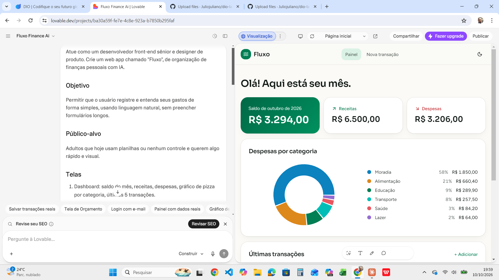
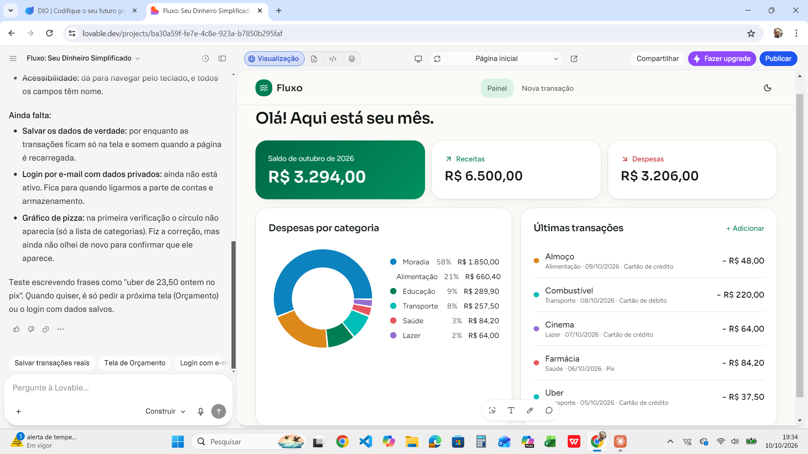
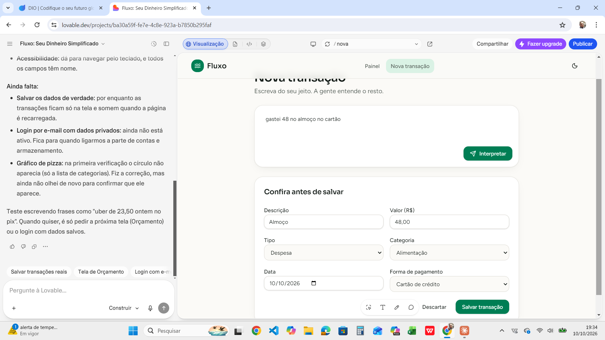
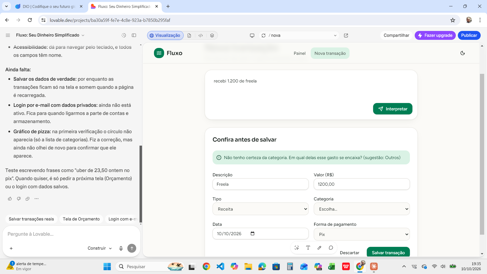

# 💸 Fluxo — Seu copiloto de finanças pessoais com IA

> Projeto do desafio **Vibe Coding: App de Organização de Finanças Pessoais com IA** (DIO).
> Construído com prompts guiando ferramentas de IA, como o **Lovable** e o **GitHub Copilot**.

## 🎯 Resumo do conceito

**Fluxo** é um app web que transforma o controle financeiro em uma conversa. Em vez de preencher planilhas, a pessoa registra gastos em linguagem natural ("gastei 48 no almoço no cartão") e a IA:

- categoriza a despesa automaticamente;
- mostra para onde o dinheiro está indo no mês;
- avisa quando uma categoria está perto de estourar o orçamento;
- sugere ajustes práticos ("seus gastos com delivery subiram 30% — que tal um teto de R$ 250?").

**Público-alvo:** pessoas que querem organizar a vida financeira sem a burocracia de planilhas ou apps complexos.

**Diferencial:** entrada por texto livre + insights em linguagem simples, sem jargão financeiro.

## ✨ Funcionalidades (MVP)

| # | Funcionalidade | Descrição | Status |
|---|----------------|-----------|--------|
| 1 | Registro por texto livre | A IA extrai valor, categoria, data e forma de pagamento; o usuário confirma antes de salvar | ✅ Pronto |
| 2 | Dashboard mensal | Saldo, receitas, despesas, gráfico por categoria e últimas transações | ✅ Pronto (dados de exemplo) |
| 3 | Orçamento por categoria | Limites com barra de progresso (verde, amarelo, vermelho) | 🔜 Próximo |
| 4 | Metas | Ex.: "juntar R$ 5.000 até dezembro" com progresso visual | 🔜 Próximo |
| 5 | Insights da IA | Resumo semanal e alertas com sugestões acionáveis | 🔜 Próximo |

**Fora do escopo do MVP:** integração bancária (Open Finance), multiusuário compartilhado, app mobile nativo.

## 🧰 Stack

- **Front-end:** React + TypeScript + Tailwind CSS + shadcn/ui (gerado via Lovable)
- **Gráficos:** Recharts
- **IA:** modelo de linguagem chamado por uma função de servidor, que devolve a transação em JSON estruturado
- **Planejado:** login por e-mail e banco de dados para persistir os dados por usuário

## 📝 Prompt final (PRD) usado com a IA

```text
Atue como um desenvolvedor front-end sênior e designer de produto.
Crie um web app chamado "Fluxo", de organização de finanças pessoais com IA.

## Objetivo
Permitir que o usuário registre e entenda seus gastos de forma simples,
usando linguagem natural, sem preencher formulários longos.

## Público-alvo
Adultos que hoje usam planilhas ou nenhum controle e querem algo rápido e visual.

## Telas
1. Dashboard: saldo do mês, receitas, despesas, gráfico de pizza por categoria,
   últimas 5 transações.
2. Nova transação: um único campo de texto ("gastei 48 no almoço no cartão").
   A IA devolve valor, categoria, data e forma de pagamento para o usuário
   confirmar ou editar antes de salvar.
3. Orçamento: limite mensal por categoria com barra de progresso
   (verde < 70%, amarelo 70–99%, vermelho ≥ 100%).
4. Metas: criar meta com valor-alvo e prazo; mostrar % concluído.
5. Insights: 3 cards com observações e sugestões em linguagem simples.

## Regras de negócio
- Categorias padrão: Moradia, Alimentação, Transporte, Lazer, Saúde, Educação, Outros.
- Valores em Real (R$), formato brasileiro (1.234,56).
- Se a IA não tiver certeza da categoria, perguntar ao usuário.
- Dados de cada usuário são privados (autenticação por e-mail).

## Design
- Visual limpo e moderno, tema claro e escuro.
- Paleta: verde-esmeralda como cor principal, neutros para o fundo.
- Mobile-first e responsivo.
- Acessibilidade: contraste AA, navegação por teclado, labels em todos os campos.

## Qualidade de código
- Componentes pequenos e reutilizáveis, tipados em TypeScript.
- Separar lógica (hooks) da apresentação.
- Comentários curtos explicando as partes principais.

## Entrega
Comece pelo Dashboard e pela tela "Nova transação" com dados de exemplo.
Depois eu peço as demais telas, uma por vez.
```

> 💡 **Por que esse prompt funciona:** define papel, objetivo, público, telas, regras, design e ordem de entrega. Pedir "uma tela por vez" reduz erros e facilita revisar o resultado.

## 🖼️ Interações com a IA

### Lovable

**1. Prompt inicial (PRD) enviado ao Lovable**



**2. Painel gerado: saldo, receitas, despesas, gráfico por categoria e últimas transações**



**3. Nova transação: a IA entende a frase e preenche os campos para o usuário conferir**



**4. Categoria incerta: a IA pede para o usuário escolher, como definido nas regras de negócio**



### GitHub Copilot
<!--  -->

### Vídeo de demonstração
<!-- [Link do vídeo](#) -->

## 🔗 Demo

- **App publicado:** https://fluxo-finance-ai.lovable.app
- Projeto no Lovable: https://lovable.dev/projects/ba30a59f-fe7e-4c8e-923a-b7850b295faf

## 🧠 O que aprendi

1. **Prompt claro vale mais que prompt longo.** Dizer público, telas e regras de negócio deu resultados muito melhores do que pedir "um app de finanças".
2. **Iterar em passos pequenos funciona melhor.** Pedir só o Dashboard e a tela de Nova transação primeiro facilitou revisar o resultado.
3. **A IA acelera, mas a revisão é minha.** Ao testar, vale conferir formatação de valores, acessibilidade e casos de borda, como o gráfico que precisou de ajuste depois da primeira versão.
4. **Documentar o processo é parte do produto.** Registrar prompts e decisões torna o projeto reproduzível e mostra raciocínio, não só resultado.

## 🚀 Próximos passos

- Telas de Orçamento, Metas e Insights
- Login por e-mail e persistência dos dados
- Integração com Open Finance
- Leitura de comprovantes por foto (OCR)

## 👤 Autor

Feito por [Juliojuliano](https://github.com/Juliojuliano)
